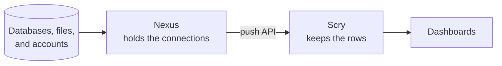

<div align="center">


# Scry

**Drag-and-drop dashboards over your own data.**

[](https://github.com/PluperfectData/Scry/actions/workflows/api.yml)
[](https://github.com/PluperfectData/Scry/actions/workflows/client.yml)
[](https://github.com/PluperfectData/Scry/actions/workflows/docker.yml)

</div>

Scry turns your data into dashboards that anyone on your team can build. Bring in a CSV file, a database, or a
brokerage account, drag charts onto a page, and choose what each one shows. There are no queries to write. Scry is
open source, and it runs on your own server, so your data stays with you.

## Contents

- [What Scry is for](#what-scry-is-for)
- [Features](#features)
- [Quick start](#quick-start)
- [Scry and Nexus](#scry-and-nexus)
- [Documentation](#documentation)
- [Contributing](#contributing)
- [Built with](#built-with)
- [License](#license)

## What Scry is for

Scry is for people who want to see their numbers without learning a BI tool: a small business watching its sales and
orders, an investor following their Charles Schwab accounts, or a team that shares a few charts everyone checks.

Each dashboard is a page of charts that you arrange by dragging. A chart reads one of your sources, a table of rows,
and adds up one column by another, such as sales by month or orders by state. People who only need to look get viewer
access: they open the dashboards, full screen included, and can't change anything.

## Features

- **Dashboards you arrange by dragging.** Drop charts onto a grid and resize them. Wide and narrow screens each keep
  their own layout, and one dashboard can be the workspace's landing page.
- **25 chart types, and tables.** Bar, line, area, pie, scatter, heatmap, Sankey, gauge, candlestick, and more,
  including maps of the world's countries and the US states. Tables sort, count matching rows, and pivot one column
  against another.
- **No queries.** Pick a source, the columns, and how to add them up: sum, average, minimum, maximum, or count. Join
  two sources on a shared column to chart them together.
- **Data from where it already is.** Upload a CSV file, connect MySQL, PostgreSQL, SQL Server, or a Charles Schwab
  account through [Nexus](https://github.com/PluperfectData/Nexus), or send rows from your own code to Scry's push API.
- **Made for a wall screen.** Full screen shows a dashboard on its own, and long tables and charts scroll through their
  data at the pace you set.
- **Workspaces, with editors and viewers.** Each workspace keeps its own dashboards and data. Editors change them, and
  viewers only look.
- **Sign in with a mailed link.** There's no sign-up: an admin invites each person, who signs in with a link sent by
  mail, or with a password if they set one.
- **A log in plain words.** The Log page lists what happened and who did it, such as a chart added or a source's rows
  arriving.
- **Set up in the browser.** A first-run installer asks for the database, the addresses, mail, and the first admin. No
  configuration files, and no command line.
- **Light and dark themes**, switched from the header.

## Quick start

Scry installs three ways. Each runs it on one computer at `http://localhost:6160`, then sets it up in the browser,
and each can set up [Nexus](https://github.com/PluperfectData/Nexus) beside it.

| Way | For | Needs |
|---|---|---|
| [On Windows](#on-windows) | Using Scry on a Windows computer | Windows 10 or 11 |
| [In Docker](#in-docker) | Running Scry in containers, on any computer | Docker Desktop, or Docker on Linux |
| [From the command line](#from-the-command-line) | Working on Scry's code | .NET 10, Node.js 24, MySQL 8.4, and Git |

All three use the same addresses, so run one at a time.

Every way starts from the code at `Pluperfect.Data/Scry` in a folder of your choice. Clone it with
`git clone https://github.com/PluperfectData/Scry.git Pluperfect.Data/Scry`, or download the ZIP from GitHub and
extract it there.

### On Windows

Right-click `install.ps1` in the Scry folder, and choose **Run with PowerShell**. It:

1. installs what's missing (.NET 10, Node.js, MySQL, and Git) through winget, and fetches Nexus and the two
   libraries Scry builds against
2. asks whether to install Nexus too
3. builds Scry
4. puts a **Scry** shortcut on the desktop, then starts Scry with a database server of its own and opens it

The installer page opens at Mail, since Scry already knows its database and addresses. Then make yourself the admin.
[Installing on Windows](docs/installing.md) has the detail.

### In Docker

Start Docker Desktop, or Docker on Linux. Then, in the Scry folder:

- **Windows:** double-click `Scry Docker.cmd`.
- **macOS or Linux:** run `sh scry-docker.sh`.

The launcher fetches Nexus and the libraries Scry builds against, and asks whether to start Nexus too, linked to
Scry. Then it builds and starts Scry with MySQL beside it, prints the installer's address with its install code, and
opens Scry. The first build takes several minutes. [Running Scry in Docker](docs/docker.md) has the detail.

### From the command line

You'll run Scry's API and its web client from their code, then set Scry up in the browser.

#### What you need

- [.NET SDK 10](https://dotnet.microsoft.com/download/dotnet/10.0), version 10.0.302 or later
- [Node.js 24](https://nodejs.org/)
- [MySQL 8.4](https://dev.mysql.com/downloads/mysql/), with a user that can create Scry's database
- [Git](https://git-scm.com/)

#### 1. Get the code

Scry builds against three other repositories, which it expects to find beside it. Clone all four into one folder:

```bash
git clone https://github.com/PluperfectData/Scry.git Pluperfect.Data/Scry
git clone https://github.com/PluperfectData/Nexus.git Pluperfect.Data/Nexus
git clone https://github.com/mnwachukwu/Pluperfect.Jwt.git
git clone https://github.com/mnwachukwu/Pluperfect.Mail.git
```

That gives you this layout. Every command below runs from the top folder.

```text
your-folder/
├── Pluperfect.Data/
│   ├── Nexus/
│   └── Scry/
├── Pluperfect.Jwt/
└── Pluperfect.Mail/
```

#### 2. Build the sign-in library

Scry's client signs in through Pluperfect.Jwt's client, which is built once:

```bash
npm install --prefix Pluperfect.Jwt/client
npm run build --prefix Pluperfect.Jwt/client
```

#### 3. Start the API

```bash
dotnet run --project Pluperfect.Data/Scry/Server/src/Scry.Api
```

The API listens on `http://localhost:6161`.

#### 4. Start the client

In a second terminal, from the same folder:

```bash
npm install --prefix Pluperfect.Data/Scry/Client
npm run dev --prefix Pluperfect.Data/Scry/Client
```

#### 5. Set it up

Open `http://localhost:6160/install`. The installer asks, in turn, for:

1. **Your database:** the MySQL server's address, a name for the database, and the user. Scry makes the database and
   its tables.
2. **The addresses** people open Scry at, already filled in for your machine.
3. **Mail**, which you can skip. On your own machine, Scry writes each mail to a file in
   `Pluperfect.Data/Scry/Server/src/Scry.Api/data/mail` instead of sending it.
4. **The first admin:** your email, and a password if you want one.

Then make a workspace, upload a CSV file on its Sources page, and add a dashboard. [Running Scry](docs/running.md)
covers the installer in full, including setting up an instance from another machine.

## Scry and Nexus

Scry shows your data, and [Nexus](https://github.com/PluperfectData/Nexus) fetches it. Nexus holds the connections,
such as a database's password or a Schwab sign-in, and copies their tables into Scry through Scry's push API. For the
sources Nexus fills, Scry never sees a password or a token.



- **Link once.** On a workspace's Settings page, enter your Nexus's address and press Link Nexus. A Nexus admin
  approves the link, and no keys are copied by hand.
- **Connect from Scry.** The Sources page then offers Nexus's connectors. Picking one opens Nexus's connect page, and
  once you're done, the tables sync into Scry.
- **See a sign-in's clock.** When a provider ends a sign-in on a clock, as Schwab does after 7 days, the Sources page
  says when, warns once it is near, and offers Sign in again. A chart whose data stopped when its sign-in ended says
  so, for viewers too.
- **Or don't.** Scry works without Nexus. CSV uploads and the push API need nothing else.

## Documentation

The [documentation](docs/README.md) covers each part in depth, with a contents page to find your way around. Good
places to start:

- [Installing on Windows](docs/installing.md) and [Running Scry in Docker](docs/docker.md): the other two ways in
- [Running Scry](docs/running.md): the installer, and setting up an instance from another machine
- [Users and workspaces](docs/users-and-workspaces.md): invites, signing in, and who may change what
- [The API](docs/api.md): every route, including the push API for sending rows from your own code
- [Configuration](docs/configuration.md): every setting, for the people who run an instance

Inside Scry, the Docs page in the header is the reference for the push API: its column types, modes, limits, and
answers.

## Contributing

Contributions are welcome. In short:

1. For anything bigger than a small fix, open an issue first, so we can agree on the approach.
2. Fork the repository, and make a branch named for your change.
3. Open a pull request into `main`. CI must pass, and a maintainer reviews it.
4. Pull requests are squash-merged, so each becomes one commit on `main`.

Contributing comes with terms: by contributing, you give the maintainer permission to relicense your contribution.
Read [CONTRIBUTING.md](CONTRIBUTING.md) before you start.

## Built with

Scry is a .NET 10 API and a React 19 client, built with Vite. It keeps its own records, such as users, workspaces, and
dashboards, in MySQL, and each workspace's rows in a DuckDB file of its own. Thank you to the authors of the
open-source packages below.

Scry also builds on three libraries of our own, checked out beside it:
[Nexus](https://github.com/PluperfectData/Nexus) for reading files and writing DuckDB,
[Pluperfect.Jwt](https://github.com/mnwachukwu/Pluperfect.Jwt) for sessions, and
[Pluperfect.Mail](https://github.com/mnwachukwu/Pluperfect.Mail) for mail. Each lists the packages it uses, and their
licenses, in its own README.

### The API (`Server/src/Scry.Api`)

| Package | Used for | License |
|---|---|---|
| [DuckDB.NET.Data.Full](https://www.nuget.org/packages/DuckDB.NET.Data.Full) | Each workspace's rows, in an in-process DuckDB file | [MIT](https://spdx.org/licenses/MIT.html) |
| [Microsoft.EntityFrameworkCore](https://www.nuget.org/packages/Microsoft.EntityFrameworkCore) | Scry's own records | [MIT](https://spdx.org/licenses/MIT.html) |
| [Microsoft.EntityFrameworkCore.Relational](https://www.nuget.org/packages/Microsoft.EntityFrameworkCore.Relational) | Migrations, and EF Core's relational parts | [MIT](https://spdx.org/licenses/MIT.html) |
| [Microsoft.EntityFrameworkCore.Design](https://www.nuget.org/packages/Microsoft.EntityFrameworkCore.Design) | Making migrations | [MIT](https://spdx.org/licenses/MIT.html) |
| [Pomelo.EntityFrameworkCore.MySql](https://www.nuget.org/packages/Pomelo.EntityFrameworkCore.MySql) | EF Core's MySQL provider | [MIT](https://spdx.org/licenses/MIT.html) |
| [Serilog.AspNetCore](https://www.nuget.org/packages/Serilog.AspNetCore) | The developer log | [Apache-2.0](https://spdx.org/licenses/Apache-2.0.html) |

### The API's tests (`Server/tests/Scry.Api.Tests`)

| Package | Used for | License |
|---|---|---|
| [Microsoft.AspNetCore.Mvc.Testing](https://www.nuget.org/packages/Microsoft.AspNetCore.Mvc.Testing) | Hosting the API in a test | [MIT](https://spdx.org/licenses/MIT.html) |
| [Microsoft.EntityFrameworkCore.Sqlite](https://www.nuget.org/packages/Microsoft.EntityFrameworkCore.Sqlite) | An in-memory database for each test | [MIT](https://spdx.org/licenses/MIT.html) |
| [Microsoft.NET.Test.Sdk](https://www.nuget.org/packages/Microsoft.NET.Test.Sdk) | Running the tests | [MIT](https://spdx.org/licenses/MIT.html) |
| [NUnit](https://www.nuget.org/packages/NUnit) | The test framework | [MIT](https://spdx.org/licenses/MIT.html) |
| [NUnit3TestAdapter](https://www.nuget.org/packages/NUnit3TestAdapter) | Running NUnit tests through `dotnet test` | [MIT](https://spdx.org/licenses/MIT.html) |
| [NUnit.Analyzers](https://www.nuget.org/packages/NUnit.Analyzers) | Catching test mistakes at build time | [MIT](https://spdx.org/licenses/MIT.html) |
| [Shouldly](https://www.nuget.org/packages/Shouldly) | Assertions | [BSD-3-Clause](https://spdx.org/licenses/BSD-3-Clause.html) |

### The client (`Client`)

| Package | Used for | License |
|---|---|---|
| [Apache ECharts](https://www.npmjs.com/package/echarts) (`echarts`) | The charts | [Apache-2.0](https://spdx.org/licenses/Apache-2.0.html) |
| [React](https://www.npmjs.com/package/react) (`react`) | The pages | [MIT](https://spdx.org/licenses/MIT.html) |
| [react-dom](https://www.npmjs.com/package/react-dom) | Drawing the pages in the browser | [MIT](https://spdx.org/licenses/MIT.html) |
| [react-grid-layout](https://www.npmjs.com/package/react-grid-layout) | The drag-and-drop grid | [MIT](https://spdx.org/licenses/MIT.html) |
| [React Router](https://www.npmjs.com/package/react-router) (`react-router`) | Moving between pages | [MIT](https://spdx.org/licenses/MIT.html) |
| [topojson-client](https://www.npmjs.com/package/topojson-client) | Reading the map files | [ISC](https://spdx.org/licenses/ISC.html) |
| [world-atlas](https://www.npmjs.com/package/world-atlas) | The world's countries, from Natural Earth's public-domain data | [ISC](https://spdx.org/licenses/ISC.html) |
| [us-atlas](https://www.npmjs.com/package/us-atlas) | The US states, from the US Census Bureau's boundary files | [ISC](https://spdx.org/licenses/ISC.html) |

<details>
<summary>The client's development tools</summary>

| Package | Used for | License |
|---|---|---|
| [Vite](https://www.npmjs.com/package/vite) (`vite`), [@vitejs/plugin-react](https://www.npmjs.com/package/@vitejs/plugin-react) | Building the client, and serving it while you work | [MIT](https://spdx.org/licenses/MIT.html) |
| [TypeScript](https://www.npmjs.com/package/typescript) (`typescript`) | Checking types | [Apache-2.0](https://spdx.org/licenses/Apache-2.0.html) |
| [oxlint](https://www.npmjs.com/package/oxlint) | Linting | [MIT](https://spdx.org/licenses/MIT.html) |
| [Jest](https://www.npmjs.com/package/jest) (`jest`), [jest-environment-jsdom](https://www.npmjs.com/package/jest-environment-jsdom), [babel-jest](https://www.npmjs.com/package/babel-jest) | Unit tests, in a simulated browser | [MIT](https://spdx.org/licenses/MIT.html) |
| [@babel/core](https://www.npmjs.com/package/@babel/core), [@babel/preset-env](https://www.npmjs.com/package/@babel/preset-env), [@babel/preset-react](https://www.npmjs.com/package/@babel/preset-react), [@babel/preset-typescript](https://www.npmjs.com/package/@babel/preset-typescript), [babel-plugin-transform-vite-meta-env](https://www.npmjs.com/package/babel-plugin-transform-vite-meta-env) | Compiling the client for Jest | [MIT](https://spdx.org/licenses/MIT.html) |
| [@testing-library/dom](https://www.npmjs.com/package/@testing-library/dom), [@testing-library/jest-dom](https://www.npmjs.com/package/@testing-library/jest-dom), [@testing-library/react](https://www.npmjs.com/package/@testing-library/react), [@testing-library/user-event](https://www.npmjs.com/package/@testing-library/user-event) | Rendering a page in a test, and using it as a person would | [MIT](https://spdx.org/licenses/MIT.html) |
| [identity-obj-proxy](https://www.npmjs.com/package/identity-obj-proxy) | Standing in for stylesheets in tests | [MIT](https://spdx.org/licenses/MIT.html) |
| [@types/jest](https://www.npmjs.com/package/@types/jest), [@types/node](https://www.npmjs.com/package/@types/node), [@types/react](https://www.npmjs.com/package/@types/react), [@types/react-dom](https://www.npmjs.com/package/@types/react-dom), [@types/topojson-client](https://www.npmjs.com/package/@types/topojson-client), [@types/topojson-specification](https://www.npmjs.com/package/@types/topojson-specification) | Types for TypeScript | [MIT](https://spdx.org/licenses/MIT.html) |

</details>

## License

Scry is free software, under the [GNU Affero General Public License, version 3 only](LICENSE). You may use it, change
it, and share it, as long as what you share stays under the same license, with its source code. If you run a changed
Scry that other people use over a network, you must offer them its source code too.

Contributions come with terms of their own, set out in [CONTRIBUTING.md](CONTRIBUTING.md#contributor-terms).
